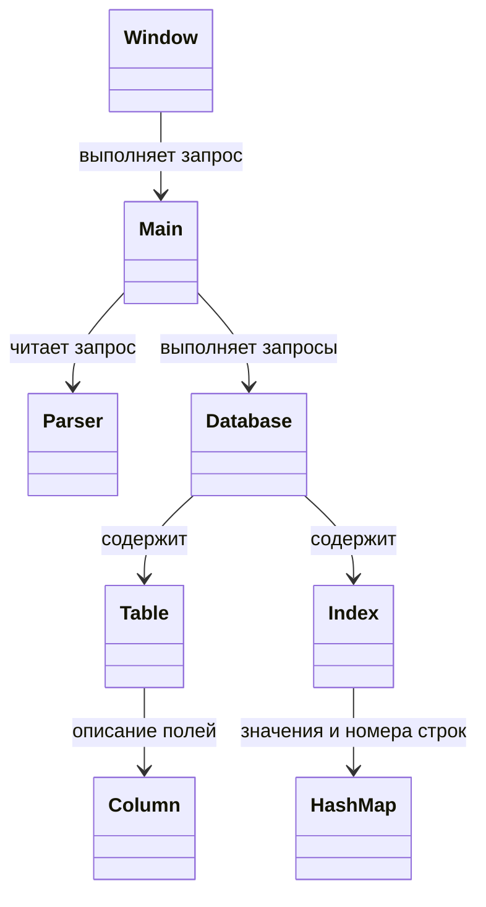
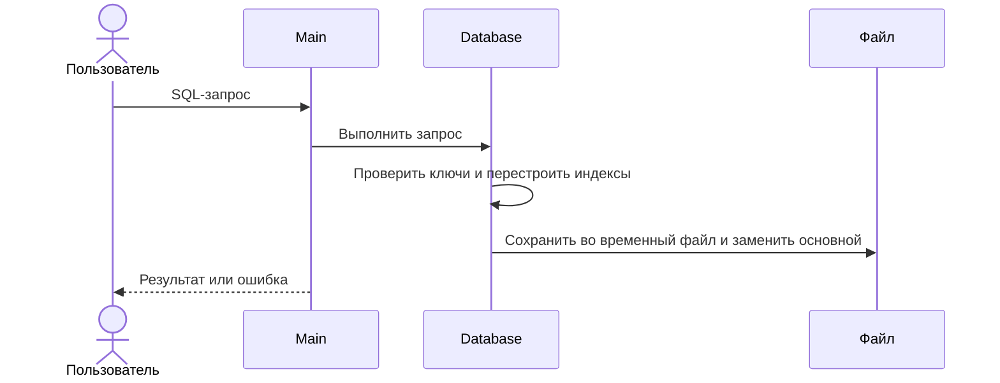

# Лабораторная работа 2: упрощённая СУБД

СУБД позволяет создавать таблицы и связи между ними. Для примера при первом запуске создаются пустые таблицы групп и студентов. Пользователь может создавать и удалять собственные таблицы.

## Распределение обязанностей в команде

- Логанов Андрей — ядро СУБД: таблицы, типы данных, проверка ключей, сохранение и загрузка базы.
- Чепортузова Полина — обработка запросов: разбор команд, выполнение операций с таблицами и индексация.
- Попова Лариса — графический интерфейс, файлы запуска, тестирование, измерение производительности и документация.

## Архитектура



`Parser` последовательно читает слова и знаки запроса, `Main` выполняет команды, `Database` содержит таблицы и индексы, `Table` хранит записи, `Column` описывает поле. Индекс построен на `HashMap`. Удаление использует `Iterator`.



Данные и индексы сохраняются в `database.dat` в текущем каталоге. При старте файл загружается, индексы перестраиваются. Перед сохранением создаётся временный файл, затем он заменяет основной; где возможно, замена атомарная. При повреждении файла программа сообщает об ошибке и не перезаписывает его. Восстановление после любого сбоя не гарантируется.

## Запуск

Установите JDK 8 или новее, перейдите в папку лабораторной и выполните:

```sh
javac -encoding UTF-8 Main.java
java Main
```

На Mac можно дважды нажать файл `Start.command`: он соберёт программу и откроет окно. Для этого нужен установленный JDK.

На Windows дважды нажмите `Start.bat`. Для запуска нужен JDK: команды `java` и `javac` должны быть доступны через PATH.

Для запуска графического окна через терминал:

```sh
javac -encoding UTF-8 Main.java Window.java
java Window
```

Введите один запрос в верхнее поле и нажмите «Выполнить запрос». Кнопка «Примеры запросов» показывает подсказку, а «Показать таблицы» выводит список таблиц; команда `SHOW TABLES;` делает то же самое в консоли. Результат или ошибка появится ниже. Окно и консоль используют файл `database.dat` в текущей папке; запускайте их по отдельности.

В консоли один запрос вводится в одной строке, `EXIT` завершает работу. Изначально таблицы пустые:

- `groups`: `id INTEGER PRIMARY KEY`, `name STRING`.
- `students`: `id INTEGER PRIMARY KEY`, `name STRING`, `grade DOUBLE`, `birth_date DATE`, `active BOOLEAN`, `group_id INTEGER REFERENCES groups(id)`.

```sql
INSERT INTO groups VALUES (1, '25КНТ-3');
INSERT INTO students VALUES (1, 'Анна', 8.5, '2007-05-10', TRUE, 1);
INSERT INTO students (id, name) VALUES (2, 'Иван'), (3, 'Мария');
SELECT * FROM students;
SELECT name, grade FROM students WHERE grade > 8;
UPDATE students SET grade = 9 WHERE id = 2;
DELETE FROM students WHERE name = 'Мария';
CREATE INDEX idx_students_name ON students (name);
SELECT * FROM students WHERE name = 'Анна';
CREATE TABLE courses (id INTEGER PRIMARY KEY, name STRING, group_id INTEGER REFERENCES groups(id));
DROP TABLE courses;
```

Типы: `INTEGER` (или `INT`), `DOUBLE`, `STRING`, `DATE`, `BOOLEAN`. Дата записывается как `'ГГГГ-ММ-ДД'`, строки — в одинарных кавычках, кавычка внутри строки удваивается. Пропущенные поля получают `NULL`, первичный ключ обязателен. `WHERE` поддерживает одно сравнение: `=`, `!=`, `<>`, `<`, `>`, `<=`, `>=`. Подзапросы, JOIN и составные условия не реализованы. Индекс используется в SELECT для сравнения на равенство; другие условия обрабатываются перебором. Индексы перестраиваются после изменения, поэтому запись больших таблиц замедляется.

## Проверка работы, тесты

```sh
javac -encoding UTF-8 Main.java Tests.java
java Tests
```

Тесты используют отдельную временную базу и проверяют типы, запросы, ограничения ключей, откат ошибок, индексы и повторную загрузку. При успешном завершении выводится число пройденных проверок.

## Производительность

```sh
javac -encoding UTF-8 Main.java Benchmark.java
java Benchmark
```

В одном запуске на 100 000 строках после 200 прогревочных запросов 1000 поисков существующего ключа заняли 532,928 мс перебором и 0,358 мс с индексом. Измерялся только поиск в памяти, без вывода, сохранения и построения индекса; результат зависит от машины и JVM. `Benchmark` работает с отдельными данными в памяти.

## Выводы

Создана СУБД с типизированными таблицами, ключами, сохранением и индексированным поиском. Индекс ускоряет поиск по равенству ценой памяти и затрат на обновление.

## Список использованных источников

1. Документация Java Platform, Standard Edition. – https://docs.oracle.com/en/java/
2. Документация по графическому интерфейсу - The Java Tutorials: Creating a GUI With Swing / Oracle. – https://docs.oracle.com/javase/tutorial/uiswing/
3. Конспекты лекций по курсу «Программирование на языке Java».
